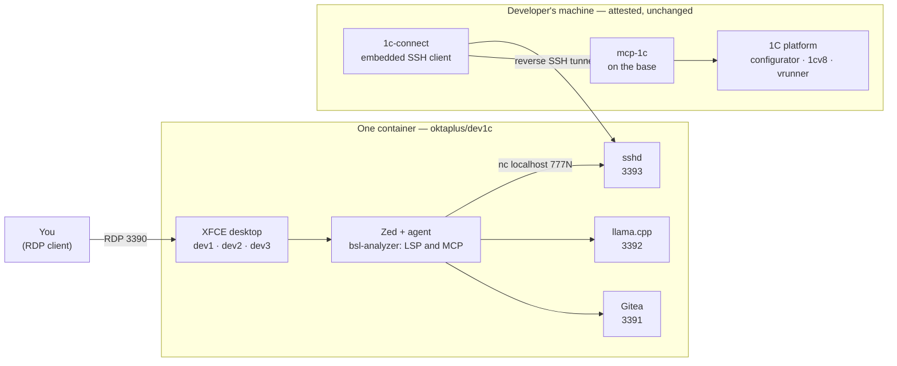

# dev1c — a 1C development environment with an AI agent

[](https://github.com/metalmon/dev1c/actions/workflows/build.yml)
[](LICENSE)
[](docs/architecture.md)

Three 1C developers, one container, an agent that can actually reach their bases — without installing anything on an attested workstation. Built and maintained by OktaPlus.

A Docker image with a desktop: connect over RDP, get Zed with a preconfigured AI agent, a language server and an MCP server for 1C. The 1C platform itself is **not** included — the configurator and `vanessa-runner` stay on the developer's machine, reachable through a reverse SSH tunnel, so an attested workstation needs no changes.

The environment inside is Russian: that is the audience. Everything around it — these scripts, comments and docs — is English.

## How it fits together

The arrow that matters is the one going right-to-left: the machine with the 1C platform **dials out** to the container, so nothing has to be installed or opened on it.



No platform to hand? [The demo stand](docs/demo-stand.md) carries a training 1C:Enterprise 8.5 and a demo base inside the container instead, and the agent sees the same ports.

## Quick start

Docker or Podman required. The kit `dev1c-kit/` holds the installer, the image and the parameters, nothing else is read:

```
dev1c-setup install        # loads the image, starts the environment, checks it
dev1c-setup status         # what is done, nothing changed
dev1c-setup check          # facts; report in last-check.txt
dev1c-setup change port=4000
dev1c-setup clean --stack  # stop; --data drops the volumes too
dev1c-setup verify         # the kit against its checksums
```

Without arguments the program prints the state (the window comes later). Every command takes `--dry-run`: it prints the plan and touches nothing. Parameters live in `dev1c.toml` next to the program, each field explained in place. No Compose: plain `docker run` moves to Podman or anything else.

A model file, if any, goes into `model/` of the kit and is named in `[model] file`; a remote OpenAI-compatible server goes into `[model] url`, `key`, `name` (the URL with its path, without the trailing `/chat/completions`: the editor appends that itself). Nothing about 1C bases is configured here: that lives with each developer in `1c-connect` — see [Reaching the 1C platform](docs/1c-platform.md).

Russian step-by-step instructions ship inside the kit as `УСТАНОВКА.md`.

## Documentation

| Page | What it answers |
|---|---|
| [Architecture](docs/architecture.md) | Why one container for three people, which four ports and why a block, where the model lives, what is installed inside |
| [Reaching the 1C platform](docs/1c-platform.md) | The reverse tunnel, the `1c-connect` kit, and what the agent sees as a plain TCP port |
| [The demo stand](docs/demo-stand.md) | The second image with the platform and a demo base inside, and how it is built and moved |
| [Development](docs/development.md) | Building a release, and the formatting and lint gates a change passes |
| [Engineering log](docs/STATUS.md) | What was decided, when, and what broke — the running record |
| [Pilot acceptance](docs/pilot-acceptance.md) | What the pilot has to demonstrate to count as done |
| [Model settings](docs/model-settings-qwen36.md) | Measured settings for the model the environment ships with |

One gotcha is worth reading before the first project: [open projects from the home directory, not from a forwarded drive](docs/architecture.md#what-is-inside) — over RDP, Zed's polling will saturate the container.

## Status

Pilot. The parts in daily use are the environment, the agent, the tunnel and the demo stand; the running record of decisions and breakages is [docs/STATUS.md](docs/STATUS.md).

The licence check is a build flag, not a fact of the binary: `onec-connect` compiles without it by default, and a commercial build adds `--features licence`. See [`setup/1c-connect/src/licence.rs`](setup/1c-connect/src/licence.rs).

## Licence

Source-available, not open source: you may read, review, audit and quote this code; running, building, deploying or modifying it needs a written agreement with OktaPlus. The terms are in [LICENSE](LICENSE), and they are short enough to read in full.

The 1C:Enterprise platform is never distributed here. Obtaining it and holding its licence is the user's own matter.

## Contributing and contact

Issues and pull requests are welcome, and [CONTRIBUTING.md](CONTRIBUTING.md) says what happens to them and what the code expects of a change. For anything with a security edge, read [SECURITY.md](SECURITY.md) first and do not open a public issue.
